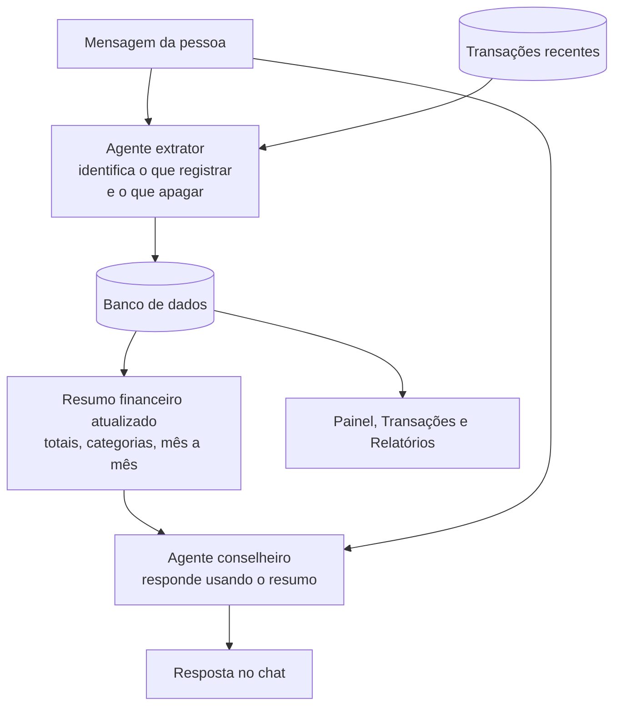

# vivIA — Assessor Financeiro com IA

A vivIA é um assistente financeiro em que a pessoa **conversa em linguagem natural** e o sistema
registra, organiza e analisa as finanças dela. Em vez de preencher formulários, basta escrever
"gastei 50 no mercado ontem" ou enviar o extrato do banco: os agentes de IA extraem as transações,
e o painel, a lista de transações e os relatórios se atualizam sozinhos.

Projeto de Iniciação Científica (IFES — Campus Serra), construído em Python com
[Reflex](https://reflex.dev) (interface web) e [AGNO](https://docs.agno.com) (agentes de IA).

## Sumário

- [O que o sistema faz](#o-que-o-sistema-faz)
- [Como funciona por dentro](#como-funciona-por-dentro)
- [Como rodar no seu computador](#como-rodar-no-seu-computador)
- [Configuração](#configuração)
- [Como usar](#como-usar)
- [Importação de arquivos](#importação-de-arquivos)
- [Estrutura do código](#estrutura-do-código)
- [Banco de dados](#banco-de-dados)
- [Segurança e privacidade](#segurança-e-privacidade)
- [Testes](#testes)
- [Publicação](#publicação)
- [Problemas comuns](#problemas-comuns)
- [Limitações conhecidas](#limitações-conhecidas)

## O que o sistema faz

| Recurso | Descrição |
|---|---|
| **Chat com a assessora** | Conversa em português. A vivIA responde com base nos dados reais registrados e pode consultar cotações do mercado (Yahoo Finance). |
| **Registro por texto** | "Recebi meu salário de 2000", "gastei 40 na borracharia dia 12": vira transação com categoria, valor, tipo e data. |
| **Correção por texto** | "Remova a entrada de 10000, era teste" ou "o mercado foi 80, não 50": o sistema apaga ou corrige o lançamento e mostra o que mudou. |
| **Importação de arquivos** | Extrato ou fatura de cartão em CSV, XLSX, OFX/QFX ou PDF. |
| **Open Finance (demonstração)** | Simula o fluxo oficial de consentimento e importação. Os dados são fictícios. |
| **Painel** | Saldo, entradas, saídas, gastos por categoria e últimas transações. |
| **Transações** | Lista completa por dia, com filtro por tipo e mês e exclusão de lançamentos. |
| **Relatórios** | Entradas x saídas dos últimos 6 meses. Clicar em um mês mostra os gastos por categoria daquele mês. Exporta para CSV (formato do Excel em português). |
| **Dois modos de uso** | **Pessoal** (suas próprias finanças) ou **Assessor Financeiro** (vários clientes ou empresas, cada um com dados isolados). |
| **Várias conversas** | Cada perfil pode ter várias conversas. As transações valem para todas. |
| **Contas e chaves por usuário** | Login por e-mail e senha, com "Esqueci minha senha" (código por e-mail) e "Alterar senha". Cada pessoa cadastra as próprias chaves de API, guardadas criptografadas. |

## Como funciona por dentro

Cada mensagem do chat passa por **dois agentes**, um depois do outro:



1. **Agente extrator** (`agents/extractor_agent.py`). Lê a mensagem e devolve uma saída estruturada
   (`agents/schemas.py`): transações novas e os ids de lançamentos que devem ser apagados. Para poder
   corrigir, ele recebe as 40 transações mais recentes do perfil. Não conversa com a pessoa.
2. **Agente conselheiro** (`agents/advisor_agent.py`). Recebe o resumo financeiro já atualizado, as
   últimas 20 mensagens e uma nota do que acabou de ser registrado ou apagado. É ele quem responde.

Os dois agentes **não fazem contas**: os totais são calculados pelo código
(`core/transaction_service.py`) e entregues prontos, para a IA não errar somas.

### Provedores de IA

| Provedor | Modelo padrão | Uso padrão |
|---|---|---|
| Groq | `openai/gpt-oss-120b` | extrator (rápido e barato) |
| OpenAI | `gpt-4o-mini` | conselheiro |
| Google | `gemini-3.8-flash` | alternativa |
| Anthropic (Claude) | `claude-sonnet-5-5` | opcional: quando a pessoa cadastra essa chave, o conselheiro passa a usá-la |

Basta **uma** chave para usar o app. Se o provedor preferido falhar ou não tiver chave, o sistema
tenta automaticamente os outros para os quais existe chave (`llm/fallback.py`).

## Como rodar no seu computador

Requisitos: Python 3.13 e conexão com a internet (na primeira execução o Reflex baixa o que precisa
para montar a interface).

```bash
# 1. Ambiente virtual
python -m venv venv
venv\Scripts\activate          # Windows
# source venv/bin/activate     # Linux/macOS

# 2. Dependências
pip install -r requirements.txt

# 3. Banco de dados (cria ou atualiza o reflex.db)
reflex db migrate

# 4. Subir o app
reflex run
```

Abra `http://localhost:3000`, crie uma conta, escolha o modo e cadastre uma chave de API em
**Configurações** (ícone de chave no topo). O Groq oferece chave gratuita.

Com Docker: `docker compose up --build` e abra `http://localhost:8000`.

## Configuração

Todas as variáveis são opcionais no uso local. Elas ficam em um arquivo `.env` na raiz (que não vai
para o GitHub).

| Variável | Padrão | Para quê |
|---|---|---|
| `GROQ_API_KEY`, `OPENAI_API_KEY`, `GOOGLE_API_KEY`, `ANTHROPIC_API_KEY` | — | Chaves "reserva" para desenvolvimento. Só são usadas se a pessoa logada não tiver chave própria. |
| `VIVIA_USAR_CHAVES_DO_ENV` | `true` | Em hospedagem, use `false`: impede que visitantes gastem as chaves de quem hospeda. |
| `EXTRACTOR_LLM_PROVIDER` | `groq` | Provedor preferido do extrator. |
| `ADVISOR_LLM_PROVIDER` | `openai` | Provedor preferido do conselheiro. |
| `GROQ_MODEL_ID`, `OPENAI_MODEL_ID`, `GOOGLE_MODEL_ID`, `ANTHROPIC_MODEL_ID` | ver tabela acima | Troca o modelo sem mexer no código (útil quando um provedor desativa um modelo). |
| `DB_URL` ou `DATABASE_URL` | `sqlite:///reflex.db` | Banco de dados. Aceita PostgreSQL. |
| `VIVIA_SECRET_KEY` | arquivo `.vivia_secret_key` | Chave mestra que criptografa as chaves de API dos usuários. **Nunca troque** depois de definida. |
| `API_URL` | `http://localhost:8000` | Só na hospedagem: endereço público do app, lido durante o build. |

## Como usar

**Registrar pelo chat**

| Você escreve | O sistema registra |
|---|---|
| `gastei 40 reais na borracharia` | gasto de R$ 40,00 em Manutenção/Veículo, hoje |
| `recebi 2560 no dia 12 de agosto` | receita de R$ 2.560,00 em 12/08 |
| `gastei 50 no mercado e 30 na padaria ontem` | dois gastos, com a data de ontem |

**Corrigir pelo chat**

| Você escreve | O que acontece |
|---|---|
| `remova a entrada de 10000, era teste` | o lançamento é apagado |
| `o mercado de ontem foi 80, não 50` | o de 50 é apagado e o de 80 é registrado |
| `o total recebido não é 39.911,80 e sim 29.911,80` | o sistema procura o lançamento que explica a diferença e o apaga; se não achar, pergunta qual é |

Toda alteração aparece no chat em um cartão de confirmação. Também é possível apagar um lançamento
pela lixeira na aba **Transações**.

**Perguntar**: "quanto gastei em setembro?", "onde posso economizar?", "quanto está a ação da Petrobras?".

## Importação de arquivos

Use o clipe ao lado do campo de mensagem e escolha antes se o arquivo é **Extrato** (conta) ou
**Fatura de cartão**.

**CSV e XLSX**: colunas nesta ordem, com ou sem linha de cabeçalho.

| data | descrição | valor | tipo (opcional) |
|---|---|---|---|
| `01/09/2026` | `Salário setembro` | `3200,00` | `Credito` |
| `03/09/2026` | `Supermercado Extrabom` | `-286,45` | |

- O CSV pode ser separado por vírgula, ponto e vírgula ou tabulação, em UTF-8 ou Latin-1.
- O valor aceita `1234.50`, `1.234,50` e `R$ 1.234,50`.
- `tipo` aceita `Credito` ou `Debito`. Vazio, é deduzido pelo sinal: no extrato, positivo é entrada;
  na fatura, positivo é compra.
- Na fatura, linhas de pagamento são ignoradas (esse valor já aparece no extrato da conta).

**OFX/QFX**: formato de exportação dos bancos, lido diretamente.

**PDF**: o texto é interpretado pelo agente extrator, então exige uma chave de API. PDF escaneado
(imagem) não é lido.

Limite de 10 MB por arquivo. Há modelos na pasta `dados/`.

**Categorias**: arquivos importados são categorizados por palavras-chave
(`core/categorizacao.py`), sem IA: Assinaturas, Compras, Salário, Supermercado, Restaurante,
Alimentação, Transporte, Combustível, Manutenção/Veículo, Saúde, Educação, Moradia, Lazer, Academia
e Taxas. Quando nenhuma regra bate, a própria descrição vira a categoria. Para ensinar uma palavra
nova, acrescente-a em `REGRAS`.

## Estrutura do código

```
assessor_financeiro/
├── assessor_financeiro.py   ponto de entrada (registra a página)
├── config.py                variáveis de ambiente, modelos, cores
├── state.py                 estado e fluxos do app: chat, upload, clientes, conversas, relatórios
├── auth_state.py            login e chaves de API (parte do estado)
├── agents/
│   ├── extractor_agent.py   agente que extrai e corrige transações
│   ├── advisor_agent.py     agente que conversa e aconselha
│   └── schemas.py           formato da saída do extrator
├── llm/
│   ├── model_factory.py     cria o modelo de cada provedor com a chave certa
│   └── fallback.py          tenta outro provedor quando um falha
├── core/
│   ├── transaction_repository.py  único módulo que lê e grava no banco
│   ├── transaction_service.py     cálculos: totais, categorias, relatório mensal, datas
│   ├── file_import_service.py     leitura de CSV, XLSX, OFX e PDF
│   ├── categorizacao.py           categorias por palavra-chave
│   ├── auth_service.py            regras de login, sessões e chaves
│   ├── security.py                hash de senha, tokens, criptografia e código de redefinição
│   ├── email_service.py           envio de e-mail (Resend ou SMTP)
│   ├── telemetry.py               registro das chamadas de IA (logs/llm_calls.jsonl)
│   └── open_finance/              demonstração do fluxo Open Finance
├── models/db_models.py      tabelas do banco
└── ui/
    ├── components.py        todos os componentes visuais
    └── pages.py             monta as telas
alembic/versions/            migrações do banco
tests/                       testes automatizados
dados/                       arquivos de exemplo para importação
```

Regras que o código segue:

- **Camadas**: `ui/` só desenha; `state.py` orquestra; `core/` tem as regras e não depende da
  interface; só `transaction_repository.py` fala com o banco.
- **Isolamento por perfil**: toda transação e mensagem pertence a um `session_id`
  (`usuario_<id>` no modo Pessoal, `cliente_<código>` para cada cliente). Nenhuma consulta é feita
  sem esse filtro.
- **Datas**: todo caminho que cria transação passa a data por `parse_data_flexivel()`.
- **Visual**: cores e medidas ficam em `config.py`.

## Banco de dados

SQLite no uso local (`reflex.db`) e PostgreSQL na hospedagem.

| Tabela | Guarda |
|---|---|
| `usuario` | contas (e-mail e hash da senha) |
| `sessaousuario` | logins ativos (hash do token, validade de 30 dias) |
| `chaveapi` | chaves de API de cada usuário, criptografadas |
| `cliente` | clientes do modo Assessor Financeiro |
| `conversa` | conversas de cada perfil |
| `chatmessage` | mensagens do chat |
| `transaction` | transações (categoria, valor, tipo, data) |

Ao alterar `models/db_models.py`:

```bash
reflex db makemigrations --message "descrição da mudança"
reflex db migrate
```

Confira o arquivo gerado em `alembic/versions/` antes de aplicar: a geração automática pode propor
remover índices que devem ficar. `python ver_banco.py` mostra as tabelas e a versão atual sem
alterar nada.

## Segurança e privacidade

- **Senhas**: só o hash (scrypt com salt) é guardado.
- **Redefinição de senha**: o código de 8 caracteres não é guardado no banco: é calculado (HMAC) com a chave mestra, o e-mail e o hash da senha atual. Expira em 15 a 30 minutos, vale uma vez e há limite de tentativas e de pedidos por e-mail.
- **Login**: o navegador guarda um token; no banco fica apenas o hash dele. Há limite de 5 tentativas
  erradas por e-mail a cada 15 minutos.
- **Chaves de API**: criptografadas (Fernet) com uma chave mestra que fica fora do banco. Nunca são
  enviadas ao navegador; a tela mostra só os 4 últimos caracteres.
- **Isolamento**: cada conta só acessa os próprios perfis e clientes, com verificação no servidor.
- **O que sai do servidor**: o texto das mensagens, o resumo financeiro e o conteúdo dos PDFs são
  enviados ao provedor de IA escolhido. Avise quem for testar e prefira dados fictícios.
- **Nunca versionar**: `.env`, `.vivia_secret_key` e `reflex.db` (já estão no `.gitignore`).

## Testes

```bash
python -m pytest -q
```

Os testes não chamam nenhuma IA: usam um banco em memória e respostas simuladas. Cobrem login e
chaves, isolamento entre contas, importação de arquivos, categorização, datas e relatórios,
fallback entre provedores, correções pelo chat e exportação.

Os testes que chamam um modelo de verdade ficam desligados por padrão (consomem créditos):

```bash
# Windows (PowerShell)
$env:RUN_LLM_TESTS="1"; python -m pytest -q -m llm
```

## Publicação

O passo a passo para publicar gratuitamente (Render + Neon) está em [DEPLOY.md](DEPLOY.md).
Em resumo: o `Dockerfile` compila a interface uma vez, o Caddy serve os arquivos estáticos e o
Reflex roda só como API, o que cabe nos 512 MB do plano gratuito.

## Problemas comuns

| Sintoma | Causa provável | O que fazer |
|---|---|---|
| "Para conversar comigo, cadastre sua chave de API" | nenhuma chave cadastrada | cadastre uma em Configurações |
| "Não consegui responder agora" | chave inválida, sem saldo ou provedor fora do ar | confira a chave; `logs/llm_calls.jsonl` mostra o erro |
| `Detected database schema changes` ao iniciar | modelos e banco fora de sincronia | `reflex db migrate` |
| Erro de migração após atualizar o código | banco antigo | `reflex db migrate`; em último caso, guarde uma cópia do `reflex.db` antes de recriar |
| Na hospedagem, a página abre mas não reage | `API_URL` ausente ou errada | defina a variável e refaça o deploy |
| Arquivo importado com valores errados | colunas fora de ordem | use data, descrição, valor, tipo |
| Mensagem do chat não virou transação | o extrator não entendeu | reescreva com valor e o que foi, ou importe um arquivo |

## Limitações conhecidas

- "Esqueci minha senha" depende de um serviço de e-mail (`RESEND_API_KEY` ou SMTP, veja `DEPLOY.md`); sem ele, quem perde a senha precisa de ajuda manual.
- O limite de tentativas de login fica na memória do servidor (use uma instância só).
- O Open Finance é uma simulação: integrar um banco real exige credenciamento.
- A categorização do chat depende da IA e pode variar; a dos arquivos é fixa por palavra-chave.
- O relatório mensal mostra os últimos 6 meses.
- Não há metas nem orçamento por categoria.
- A vivIA apoia a organização financeira e não substitui um profissional habilitado.

## Documentos relacionados

- [DEPLOY.md](DEPLOY.md) — publicação
- [AGENTS.md](AGENTS.md) — guia para assistentes de IA que trabalham no código
- [CLAUDE.md](CLAUDE.md) — acompanhamento de tarefas no Notion
